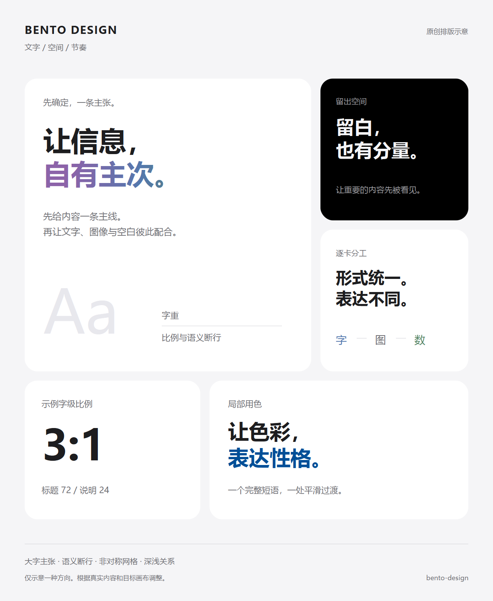

# Bento Design

中文大字、清晰主次、局部渐变与有节奏的卡片布局。

A design skill for typography-led Bento layouts, clear hierarchy, restrained gradients and purposeful imagery.

## Showcase / 效果展示

四张由本 Skill 指导、使用内置图像工具制作的概念展示：文字主导、产品特写、信息网格与家庭储能方案海报。前三张为通用虚构概念，第四张已移除身份与品牌信息；均不代表实物参数、真实应用截图或实测效果。

Four AI concept examples guided by this skill: typography, a product close-up, an information grid and an anonymized energy-dispatch poster. The first three are generic fictional concepts; identifying names and branding have been removed from the fourth. They do not demonstrate real product specifications, application screenshots or measured results.


| 产品特写 / Product close-up | 信息网格 / Information grid |
| --- | --- |
|  |  |

**方案海报 / Concept poster**

<p align="center">
  
</p>

[生成提示词 / Generation prompts](docs/showcases/prompts.md)

## 中文

`bento-design` 帮助设计海报、发布会信息页、演示文稿和网页展示区。它从内容主张、语义断行、字重和字图关系开始，再选择网格；不会把所有任务都套成一张大图和三个同构功能框。

包含四种方向：宣言排版、产品特写、信息 Bento 与多图画廊。附带局部 CSS、通用布局配方、图像生成提示词骨架、四张 AI 概念展示与原创排版示意。

### 安装

下载或克隆本仓库，在仓库根目录打开 PowerShell 7：

```powershell
pwsh -File .\scripts\install.ps1
```

脚本复制 `SKILL.md`、`agents`、`assets`、`references`、`LICENSE` 与 `NOTICE.md` 到本机 Skills 目录；优先读取 `CODEX_HOME`，否则使用用户目录下的 `.codex/skills`。目标已有同名目录时停止，不覆盖现有内容。开始新对话后使用 `$bento-design`；如果当前客户端没有刷新技能列表，重新打开客户端。

需要自定义 Skills 根目录时：

```powershell
pwsh -File .\scripts\install.ps1 -SkillsDirectory 'D:\MySkills'
```

升级时先将旧版本移到 Skills 目录之外作为备份，再运行安装。不要把两个同名版本同时放在 Skills 搜索目录中。

### 使用

```text
使用 $bento-design，把这六条产品卖点做成一张 3:4 中文海报。
先确定一个主张，再安排字重、语义断行、逐卡角色和渐变范围。
保留原始参数，缺少素材的位置明确标出。
```

```text
使用 $bento-design，重做当前页面的功能展示区。
采用文字主卡与一处深色卡，保留现有文案和交互，适配手机布局。
```

```text
使用 $bento-design，先给我一份 16:9 发布会页面布局方案，不写代码。
说明主张、文字层级、图片位置和素材缺口。
```

### 内容与边界

- [SKILL.md](SKILL.md)：工作流与验收。
- [字重、比例与色彩](references/typography-color.md)：字体角色、中文断行与渐变范围。
- [参考图参数台账](references/reference-measurements.md)：19 张学习图中的原始字号、默认字距、行/段距、完整色号、卡缝与短边 18% 圆角近似；区分原图标注、计算换算和实施建议。
- [布局配方](references/layout-recipes.md)：四种方向与局部 CSS 用法。
- [图像方向](references/image-direction.md)：生成提示词及针对性纠错。
- [tokens.css](assets/tokens.css)：带 `bd-` 前缀的可选网页起步样式。

说明主要使用中文；输出语言、品牌、技术栈与载体由用户需求决定。Skill 本身不提供图像模型、设计软件或自动导出引擎，实际产物依赖宿主可用工具。数字比例是设计起点，不是视觉效果保证或品牌官方规范。

### 检查

```powershell
python -X utf8 .\scripts\validate.py
```

检查入口名称、元数据、文件集合、UTF-8、本地引用与示意图的安全结构。它不能代替字体、图片和最终画面的视觉验收。安装脚本需要 PowerShell 7，校验脚本只需 Python 3.10+ 标准库；正常调用 Skill 不要求运行这些脚本。

## English

`bento-design` is a reusable skill for posters, presentation pages and web feature sections. It starts with the message, semantic line breaks, font weights and the relationship between text and imagery, then chooses a grid.

Its four directions are editorial statements, product close-ups, information Bento layouts and image galleries. It includes scoped CSS, layout recipes, an image-prompt scaffold, four AI concept examples and an original diagram.

The [reference measurement register](references/reference-measurements.md) records explicit type sizes, default tracking labels, line and paragraph spacing, full HEX palettes, card gaps and the short-edge 18% corner approximation from 19 study screenshots. Source annotations, calculations and implementation defaults are kept distinct. The source screenshots are not distributed.

### Install

Download or clone this repository, then run from its root in PowerShell 7:

```powershell
pwsh -File .\scripts\install.ps1
```

The installer respects `CODEX_HOME`, otherwise using `.codex/skills` under the user directory. It refuses to overwrite an existing `bento-design` directory. Use `-SkillsDirectory` to choose a different skills root. Start a new conversation after installation; reopen your client if its skill list has not refreshed.

### Use

```text
Use $bento-design to create a 3:4 poster from these six product features.
Choose one core message, define text hierarchy and card roles, and use a gradient only where it serves the message.
Preserve the supplied facts and clearly mark missing assets.
```

```text
Use $bento-design to redesign this page's feature section.
Use a typography-led main card and one dark card. Preserve existing copy and interactions, and adapt the layout for mobile.
```

The instructions are mainly in Chinese; the requested language and output medium remain under the user's control. This skill does not include an image model, design application or export engine. The host needs suitable tools for the requested artifact. Numeric ratios are starting points, not guarantees or official brand specifications.

Run `python -X utf8 scripts/validate.py` for structural checks using Python 3.10+ and its standard library. Visual inspection is still required for generated work.

## License / 许可

[MIT](LICENSE). See [content and asset notes](NOTICE.md). This is an independent design tool with no claimed official brand affiliation.

## Preview / 原创示意

以下为通用文字与几何图形构成的原创排版示意，不含第三方照片、标志或真实产品数据。预览展示一种文字主导方向，不要求所有作品都复制同一布局。

An original typography-and-geometry diagram, with no third-party photography, logos or real product data. It illustrates one direction, not a mandatory template.



[Editable SVG / 可编辑 SVG](docs/preview.svg)
