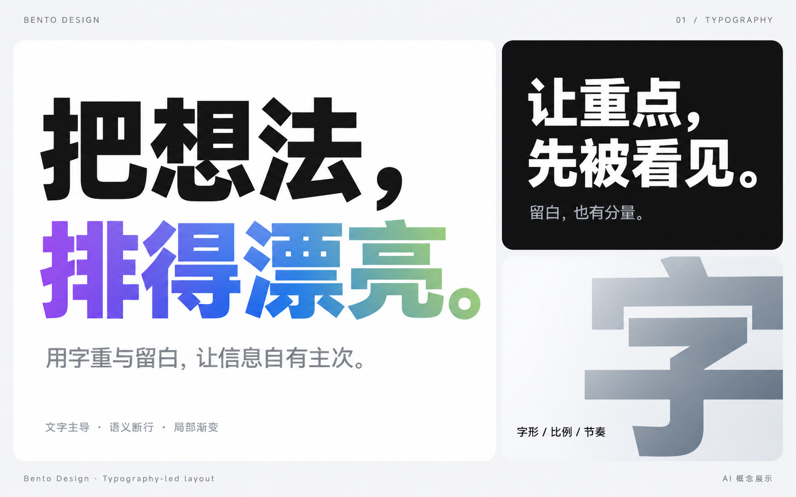
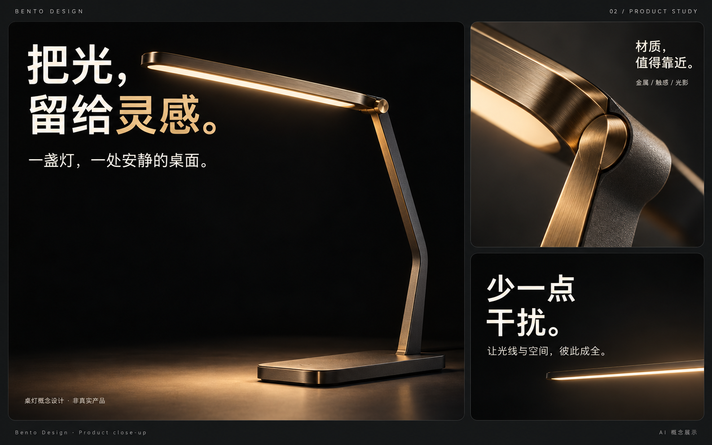
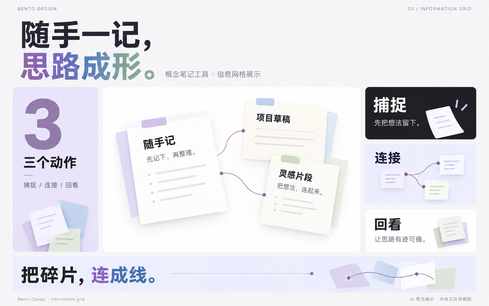
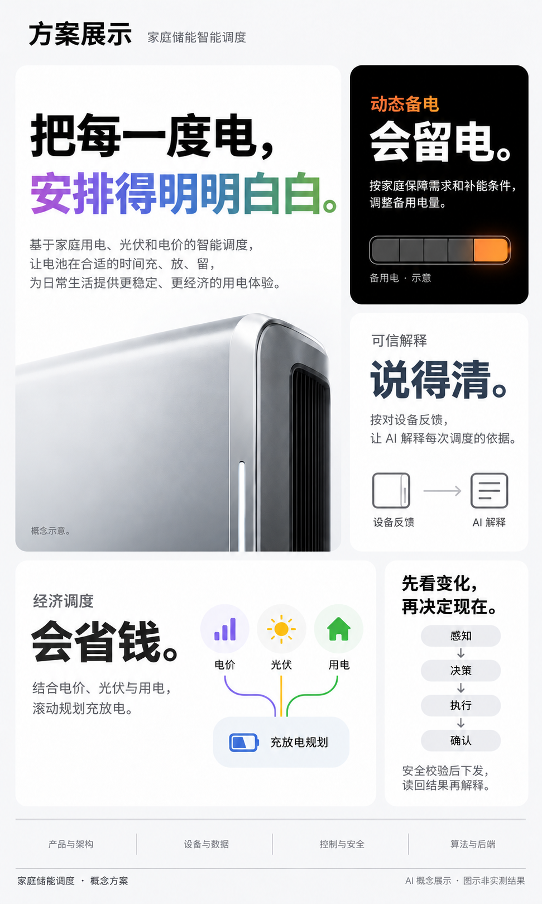

# Showcase generation prompts

生成方式：内置 image_gen；每张示例单独生成或编辑。
用途：Bento Design 开源仓库的概念展示，不代表实物参数、真实应用截图或实测效果。
01–03 没有使用原始教程截图、真实品牌标志或用户项目海报作为输入图。04 根据用户提供的 AI 概念海报编辑，移除了身份与品牌信息；原输入图不公开分发。
以下保留实际使用的提示词；不保证相同提示词每次产生完全相同的图像。

Generated or edited with the built-in image tool, one call per example. Examples 01–03 are generic fictional concepts. Example 04 anonymizes a user-provided AI concept poster; the original input is not distributed. These examples do not establish real product specifications or measured results. Prompts are included for transparency and reuse; outputs are not deterministic.

## 01 — Typography / 文字主导



```text
Use case: ads-marketing.
Create a finished landscape 16:10 editorial showcase image for an open-source design skill called “Bento Design”. Flat graphic design artwork, not a photograph of a printed poster. Crisp Chinese typography and highly polished asymmetrical Bento composition, generous precision whitespace. This is the first hero image in a repository README, so the design must be immediately legible as a thumbnail.

Canvas near-white #F5F5F7, white rounded cards, one deep-black card, typography #1D1D1F and secondary #6E6E73. High-end consumer-electronics launch editorial mood without any real company or product identity. No product photography in this example: typography is the visual hero. Neutral modern Chinese sans-serif, semibold display and regular explanatory text, around 3:1 display-to-body contrast. Clean aligned card edges and consistent narrow gutters, no decorative shadows or borders.

Top margin has small “BENTO DESIGN” at left and tiny “01 / TYPOGRAPHY” at right.
Main area: a large white card spanning about two thirds of the width and full height of the body, with a dramatically large two-line statement:
“把想法，”
“排得漂亮。”
First line black; entire second line a continuous sophisticated purple-to-blue-to-muted-green horizontal gradient. The main headline dominates. Below it, with ample whitespace, a much smaller grey sentence:
“用字重与留白，让信息自有主次。”
At the bottom of this large card, a quiet tiny line “文字主导 · 语义断行 · 局部渐变”.
Right third: two stacked cards with different internal compositions. Upper card deep black, white medium-large two-line statement “让重点，”“先被看见。” and one tiny grey line “留白，也有分量。” Lower card very pale grey-white, a very large cropped Chinese character “字” as a graphic form in subtle grey-blue, and a small black caption “字形 / 比例 / 节奏”. Make this lower card a typography study, not a fake empty UI.
Bottom margin: small “Bento Design · Typography-led layout” and unobtrusive “AI 概念展示”.
All specified Chinese text must be correct and sharply rendered. Keep all content within safe margins. No third-party logos, Apple marks, real brands, app screenshots, watermarks, fake metrics, buttons or stock 3D icons. No large colored pill labels. Avoid repeating the same component structure in every card. The effect should be a confident editorial composition whose hierarchy works before the rounded boxes are noticed.
```

## 02 — Product study / 产品特写



```text
Use case: ads-marketing.
Create a beautifully finished landscape 16:10 concept-product showcase image for the open-source skill “Bento Design”. A flat editorial design composition, not a poster photographed in a room. This example demonstrates a dark, sophisticated product-close-up Bento direction. Original generic desk-light concept only, no real brand or existing product likeness.

Palette: charcoal canvas #171918; deep black product card; one slightly lighter graphite card; warm ivory typography, restrained warm brass and amber emitted light. Modern precise Chinese sans-serif, large but not ultra-black/chunky type, medium/semibold statement and regular explanations. Shared rounded corners and narrow perfectly aligned gutters. Sophisticated consumer-electronics editorial art direction, restrained, sculptural, meticulously lit.

Top quiet header “BENTO DESIGN” left, “02 / PRODUCT STUDY” right.
Main left two-thirds card is deep black and contains a photorealistic industrial-design study of one elegant matte graphite and brushed-brass desk lamp: a slender asymmetric bent metal arm supporting a narrow oblong horizontal light bar, no circular LED ring, no conventional bulb shade, one discreet slim weighted rectangular base. Show the original lamp at a dramatic three-quarter side angle, beautifully precise metal edges, warm diffuse light falling on the base. Isolate it on black, no home or full room, no clutter, no floating objects or sci-fi light trails. The lamp itself is the dominant form, with lots of black air around its silhouette; one edge may crop intentionally at the bottom. At top of this product card, a large restrained two-line Chinese statement:
“把光，”
“留给灵感。”
Use warm white, with only “灵感” having a subtle warm ivory-to-soft-gold vertical tonal gradient. Below in a smaller readable weight: “一盏灯，一处安静的桌面。”
Tiny note at the card bottom “桌灯概念设计 · 非真实产品”.

Right third: upper graphite card dominated by a close-up photograph-like macro of brushed brass meeting matte graphite, showing fine tactile grain and an elegant joint. Small headline near one edge “材质，值得靠近。” and tiny line “金属 / 触感 / 光影”. Make this card image-led, different from the large hero.
Right lower card is nearly black, typography-led with modest large warm-white words “少一点干扰。” on two short lines if needed, and a much smaller line “让光线与空间，彼此成全。” A minimal thin horizontal light bar can sit near the bottom, otherwise rely on negative space. No icons, pill labels, product spec meters or made-up numbers.

Bottom quiet footer “Bento Design · Product close-up” and “AI 概念展示”.
Exact Chinese rendering, sophisticated ratios and spacious visual grouping. No logos, Apple symbols, real product photos, actual sales claims, watts, lumens, battery life, certification badges, fake UI, buttons, visible watermarks or external framing. Show clear material realism and editorial typographic contrast rather than a toy-like 3D icon illustration.
```

## 03 — Information grid / 信息网格



```text
Use case: ads-marketing.
Create a finished landscape 16:10 showcase image for the open-source skill “Bento Design”, demonstrating a denser, varied information Bento grid around an entirely fictional note-taking concept. Flat editorial artwork, not a device mockup or screenshot of any real application. This third example should differ visibly from the previous common large-left-card/two-right-cards composition: use a central wide hero, a slim left column and small supporting cards that lock to an invisible grid.

Art direction: calm off-white #F5F5F7 canvas, white and soft lavender cards, one small near-black card. Rounded rectangles, narrow consistent gutters, precise shared baselines. Restrained plum, blue and sage accents; dark charcoal text. Professional Chinese sans-serif, semibold large text, regular small text. The main headline clearly dominates, then the central concept view, then secondary labels. Lots of intentional blank space inside the denser grid; no glow, glossy 3D icons, glassmorphism or fake stats.

Quiet top header “BENTO DESIGN” left and “03 / INFORMATION GRID” right.
Upper title area is typographic, with a large two-line statement
“随手一记，”
“思路成形。”
First line charcoal, second line a smooth muted plum-to-blue-to-sage gradient across the complete phrase. Nearby small grey context “概念笔记工具 · 信息网格展示”. Keep the title group above or around the grid without an oversized full-page box.

Grid content underneath:
- A central largest white hero card shows a clean original note workspace as a flat paper-and-text composition, not a branded app window. Only a few clearly legible note sheets with generous whitespace, headings “随手记”, “项目草稿”, “灵感片段”. Optional very short note text “先记下，再整理。” and “把想法，连起来。”. Small colored tabs and thin neutral lines can organize the sheets. No browser chrome, real app logo, invented user avatar or fake controls.
- Slim left column: one tall lavender card dominated by the large numeral “3”, caption “三个动作”, and unobtrusive “捕捉 / 连接 / 回看”. This is a count of the three displayed design-concept actions, not a performance metric.
- A small deep-black supporting card: large white Chinese word “捕捉”, with small grey text “先把想法留下。” Make it text-led.
- A narrow pale supporting card: the word “连接” and a precise minimal flat diagram of three small paper shapes connected by thin plum lines. No icons on pedestals.
- A small white supporting card: “回看”, with small text “让思路有迹可循。” No charts or percentages.
- One bottom horizontal card or strip: a short confident statement “把碎片，连成线。” with generous whitespace and restrained purple-blue accent. It should provide a quiet landing, not another busy feature card.

Footer small “Bento Design · Information grid” and clearly readable “AI 概念展示 · 非真实应用截图”.
Render only the supplied Chinese copy, no invented headings, random Latin filler or garbled microtext. No actual company/product branding, third-party logos, real application UI, financial outcomes, fake efficiency gains, star ratings, downloads, performance percentages, purchase buttons or QR codes. Give each card a distinct visual role, vary its size and content density, and preserve an orderly coherent outer grid.
```


## 04 — Energy dispatch / 脱敏方案海报



根据用户提供的 AI 概念海报编辑，仅公开脱敏后的图像。输入图不随仓库分发。

```text
编辑提供的中文家庭储能调度海报，制作可公开展示的去标识版本。此次只做身份信息脱敏；完整保留原来的设计、版式、正文、概念产品局部、配色、渐变、功能卡、图标、箭头和画布尺寸。干净地重排指定文字，不要用马赛克或黑条遮挡。

必须完成的脱敏：
1. 顶部左侧原有的队伍/项目专有名称，替换成通用标题“方案展示”，字体、字号和位置与原名称相近。其右侧通用说明“家庭储能智能调度”保留。
2. 顶部右侧整处公司与产品品牌字样彻底删除，恢复为原有浅灰白背景，不添加任何新品牌、标志或组织名。
3. 海报底部四栏署名中的全部“@昵称”彻底删除。每栏仅保留通用职责：“产品与架构”“设备与数据”“控制与安全”“算法与后端”。职责文字可稍向上调整并垂直居中，四栏分隔线保留。不能留下昵称、字母缩写、个人姓名或其变体。
4. 最底部左侧包含公司、赛事、届次和赛道的整行文字全部移除，改为通用文字“家庭储能调度 · 概念方案”。不能残留任何赛事名称、公司名称、队名或身份信息。
5. 最底部右侧说明替换为“AI 概念展示 · 图示非实测结果”。
6. 再检查整张图，确保没有队名、品牌、公司、赛事名、个人昵称或姓名残留，也不要在产品机身上新加商标。

必须保持不变：
“把每一度电，”“安排得明明白白。”两行大标题及渐变；其下原有三行通用解释；银色设备概念特写；“动态备电 / 会留电”“可信解释 / 说得清”“经济调度 / 会省钱”的功能文案；“备用电 · 示意”；“电价 / 光伏 / 用电”关系图；四步流程和安全说明。除上述脱敏区域外不改字，不增加效果承诺、实测数据、认证、售价或宣传信息。
输出完整、清晰的竖版平面海报。
```
